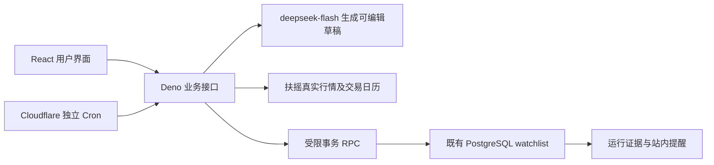

# 观澜 · 可配置自选股监控

把自然语言关注点变成长期运行、可以核对依据的监控任务。面向需要关注沪深 A 股目标价，又不希望反复手动查价的个人投资者。

- **在线产品**：https://ucdte4eh02uv.meoo.info
- **源码仓库**：https://github.com/Yilin291/InvestmentMonitor
- **演示视频**：[128秒中文演示](submission/demo-v14.mp4)（[采集和剪辑说明](submission/VIDEO.md)）
- **交付版本**：前端 static v14；后端 Deno v20；数据库增量迁移 001–013。
- **评审入口**：使用交付包私密访问说明中的演示口令；无须提供行情或模型 API Key。口令不放在公开仓库。

## 三分钟体验

1. 登录，点击“创建监控”，输入“招商银行日收盘价低于40元时提醒我，滚动24小时冷却”。
2. 生成并采用草稿，核对股票名称/代码、比较方向、阈值；可以手工修改，或添加 AND/OR 条件。
3. 点击试运行，核对真实日收盘价、交易日期、来源、不复权/CNY 口径和判断结果。
4. 明确确认启用。Cloudflare Cron 在浏览器关闭后继续调用秒悟业务接口；启用不等于已执行，状态以运行记录为准。
5. 在监控台查看已执行任务及站内通知，打开证据查看为什么触发或未触发。支持编辑版本、暂停、恢复和软删除保留历史。

也支持北京时间指定时刻的一次性提醒。现有演示任务包含真实满足、不满足、旧盘中数据无法判断及日期提醒结果。共享演示账户最多10个未删除任务；如达到上限，请删除自己创建的测试任务，保留已有演示证据。

## 核心设计



借鉴 UnifiedModel 的实体、数据、关系分离思想，未引入该项目运行时。Instrument 描述标的，Observation 保存真实观察，Evidence 关联观察，Run 绑定不可变 RuleVersion；任务运行状态与规则版本分离。价格与日期规则共用任务生命周期和执行记录。

AI 仅负责自然语言提取、澄清和草稿生成。十进制价格比较、三值 AND/OR、事件段、冷却和幂等由确定性程序完成；AI 无权自动启用或交易。外部取数在事务外，数据库事务在写回前复核租约、版本、生命周期和归属，并原子保存 Run/Evidence/Notification。

首次有效满足可提醒，连续满足不重复；有效不满足后重新满足进入新事件段，仍受滚动冷却约束。unknown 不重置事件段。暂停和编辑隔离在途旧结果；过期租约由后续调度接管。缺失、过期、冲突、接口失败或交易日覆盖不明时降为 unknown，并展示原因；不补造漏检期间的价格变化。

## 数据使用和范围

扶摇提供实际生产使用的沪深 A 股元数据、日线及交易日历；iFinD MCP 完成了早期能力验证，不宣称已集成公告监控。日线固定 `interval=1d&adjust=none`，币种 CNY，采用已完成且覆盖预期交易日的数据。供应商数据和 API 凭证不随源码公开分发。

[日收盘契约](deploy/DAILY_CLOSE_CONTRACT.md)记录有效性规则；[沪深范围](deploy/SH_SZ_SCOPE.md)记录标的及日历边界。缓存按完整市场/标的/日期隔离；界面显示数据日期和取得时间，日期不伪装成精确成交时刻。

## 运行和验证

前端 React 18 / Ant Design 5 / Vite 7；Three.js 用于界面助手，许可证在 [frontend/vendor/THREE-LICENSE.txt](frontend/vendor/THREE-LICENSE.txt)。业务接口 Deno，持久化 Supabase HTTP → 受限 PostgreSQL RPC，独立调度为 Cloudflare Worker。主要外部服务需要维护者的有效账号和密钥。

建议 Node 22.12+，本次验证使用 Node 26。以下命令不修改生产业务：

```sh
npm run build
node --test tests/*.test.mjs validation/cloudflare/worker.test.mjs
```

构建输出 `dist/`，正式同源 API 前缀固定 `/sb-api/functions/v1/watchlist-api`。本地前端开发默认代理指向旧 Python 参考服务；**当前产品的完整体验以线上 URL 为准**，不能把 `npm start` 的旧 Python 实现当作当前日收盘后端。

维护部署见 [运行手册](deploy/RUNBOOK.md)、[Deno测试说明](deploy/TESTING_DENO.md)、[云调度说明](validation/cloudflare/README.md)。Deno 入口 `functions/watchlist-api/index.ts`。现有生产项目已应用001–013迁移，禁止重复覆盖；新环境需按部署文档配置数据库、受限RPC、Secrets和同源入口。

生产 Secrets 包括 APP_ORIGIN、DEMO_PASSWORD、SESSION_SECRET、TICK_SECRET、WATCHLIST_GATEWAY_ANON_KEY、WATCHLIST_DATA_ORIGIN、DEEPSEEK_API_KEY、FUYAO_API_KEY；SUPABASE_SERVICE_ROLE_KEY由平台注入。浏览器不能获得服务端密钥。不要提交真实 `.env`、数据库备份、生产配置或会话凭证。

Cloudflare 每分钟发起独立时隙；每次最多处理1任务，日期优先。调度器仅持双层tick凭证，无数据库service-role/行情密钥；无公开 HTTP 触发入口。同一时隙重试复用幂等键。网页刷新只读状态，不执行tick。

## 验证记录与已知边界

[交付说明](submission/SUBMISSION.md) · [证据索引](submission/EVIDENCE_INDEX.md) · [AI使用记录](artifacts/AI_USAGE.md) · [验证报告](VALIDATION_REPORT.md)

- 产品70项、调度器10项离线用例；真实接口、SQL事务、云定时和浏览器分别留证，离线通过不替代线上验收。
- 真实云执行已有沪深股票满足/不满足结果及日期提醒；同键重放不重复，跨部署持久化，受控中断后自动恢复。30分钟31时隙观察中一次健康探测超时、下一分钟恢复，未宣称零故障。
- 同实例隔离恢复验证15张业务表内容相等，不是跨实例灾备；部分状态机场景使用明确隔离TEST，不伪装真实市场穿越。
- 仅日收盘、站内持久化提醒、单共享演示账户。未做盘中实时、公告、热度、跨类型复杂条件、外部推送、多租户或交易。每tick最多1任务，不承诺分钟级准时；一次性提醒允许24小时内迟到补发，超过则记录missed。
- 自定义 OpenAI/Anthropic 兼容模型设置会影响共享账户；失败明确提示并回退内置模型。真实 DeepSeek 调用已验证，Anthropic仅离线协议测试；不建议评审在共享账户填个人Key。密钥服务端加密；恢复业务备份后自定义Key需重填。
- 日历对未覆盖年份、临时停市或冲突情况降为unknown。周末演示采用最近已完成交易日，不冒充此刻盘中价格。

演示视频随本仓库及小于30MB的交付包提供，为最终v14实际页面采样剪辑，带中文合成旁白；不是连续全帧录屏。历史v7视频不作为最终交付。
